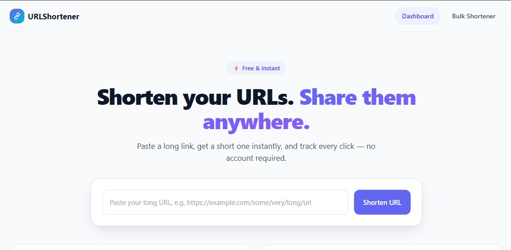

# URLShortener

A small, fast, secure URL shortener — built as a portfolio-quality Node.js MVP. Paste a long URL, get a short one instantly, track clicks, shorten in bulk, and export everything to Excel.




## Features

- **Single URL shortening** — paste a long URL, get a short one instantly.
- **Redirects with click tracking** — every visit to a short link is counted and redirects to the original URL.
- **URL management dashboard** — see every link you've created, copy/open/delete it.
- **Bulk URL shortening** — paste up to 100 URLs at once; valid ones are shortened, invalid ones are reported with a reason.
- **Excel export** — download your URLs (or a specific bulk batch) as a clean, formatted `.xlsx` file.
- **Security by default** — Helmet CSP, rate limiting, strict server-side URL validation, parameterized SQL, and Excel formula-injection protection (see [Security](#security) below).

## Tech Stack

| Layer | Choice |
|---|---|
| Frontend | Vanilla HTML, CSS, JavaScript (no framework, no build step) |
| Backend | Node.js + Express.js |
| Database | SQLite via `better-sqlite3` |
| Short IDs | `nanoid` |
| Excel export | `exceljs` |
| Security | `helmet`, `express-rate-limit` |
| Logging | `morgan` |

## Architecture

Small modular monolith: routes → controllers → services → repositories, with SQLite accessed synchronously through `better-sqlite3` (no ORM). The frontend is static HTML/CSS/JS served directly by Express — no build step, no client-side framework.

```
src/
  server.js, app.js       # entry point + Express app
  config/                 # env-driven configuration
  routes/                 # route definitions
  controllers/            # HTTP layer
  services/               # business logic (validation, short codes, bulk, Excel)
  repositories/            # parameterized SQL access
  middleware/              # security headers, rate limiting, error handling
  database/                # SQLite connection + schema init
  utils/                   # URL validation, Excel sanitizer, error types
public/
  index.html, bulk.html, 404.html
  css/, js/                # vanilla CSS + JS, no build step
```

API routes (`/api/*`) are registered before the catch-all `/:shortCode` redirect route so the two can never collide, and `/api/urls/export` is registered before `/api/urls/:id` so `export` is never parsed as an id.

## Installation

Requires **Node.js 18+**.

```bash
git clone <this-repo-url>
cd url-shortner
npm install
cp .env.example .env
npm run dev
```

The app starts on `http://localhost:3000` (configurable via `.env`). The SQLite database is created automatically on first run — no manual setup required.

```bash
npm start   # production mode
npm run dev  # development mode, auto-restarts on file changes
npm run lint # ESLint
```

## API

| Method | Path | Description |
|---|---|---|
| `POST` | `/api/urls` | Create one shortened URL — `{ "url": "https://..." }` |
| `GET` | `/api/urls` | List all URLs + stats (`totalUrls`, `totalClicks`) |
| `GET` | `/api/urls/:id` | Get one URL's details |
| `DELETE` | `/api/urls/:id` | Delete a URL |
| `POST` | `/api/urls/bulk` | Create many URLs at once — `{ "urls": [...] }`, max 100 |
| `GET` | `/api/urls/export` | Download all (or `?ids=1,2,3`-selected) URLs as `.xlsx` |
| `GET` | `/:shortCode` | Redirect to the original URL (increments click count) |

All error responses share one shape:

```json
{ "error": { "code": "INVALID_URL", "message": "Please provide a valid HTTP or HTTPS URL." } }
```

## Security

- Server-side URL validation: only `http`/`https` accepted, malicious schemes (`javascript:`, `data:`, `file:`, etc.) and userinfo-disguised URLs (`https://trusted.com@evil.com`) are rejected.
- Self-referential short links (one short URL pointing at another) are rejected.
- Parameterized SQL everywhere — no string-concatenated queries.
- Excel formula-injection protection on every exported cell.
- Rate limiting on all write endpoints (create, bulk create, delete) and on Excel export, with correct client-IP resolution behind a reverse proxy (`TRUST_PROXY`).
- Helmet security headers with a strict same-origin Content-Security-Policy (no inline scripts/styles).
- Centralized error handling — no stack traces, SQL errors, or internal paths ever reach an HTTP response.

## License

[MIT](LICENSE)
